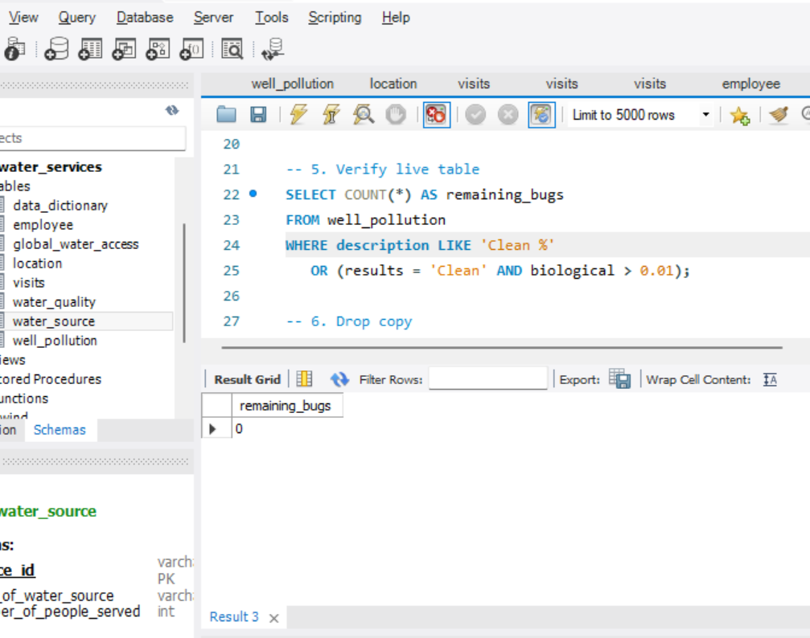
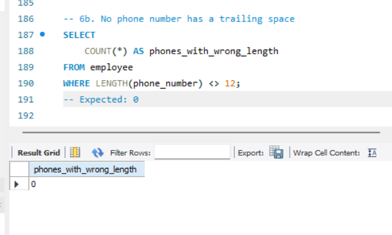
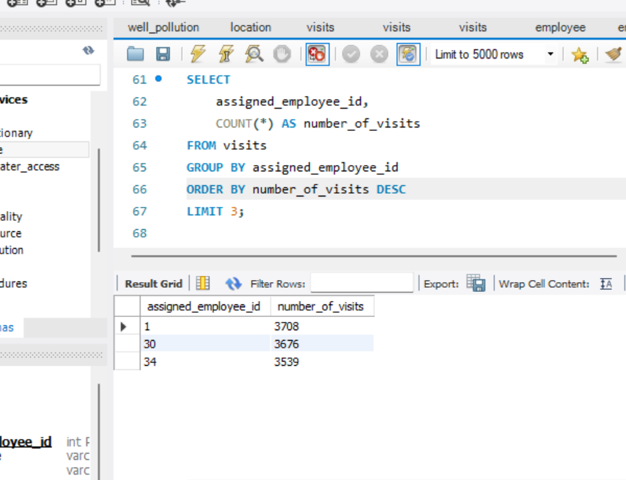
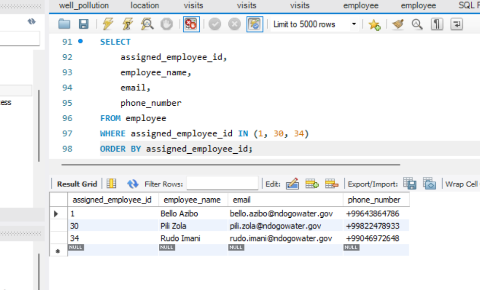
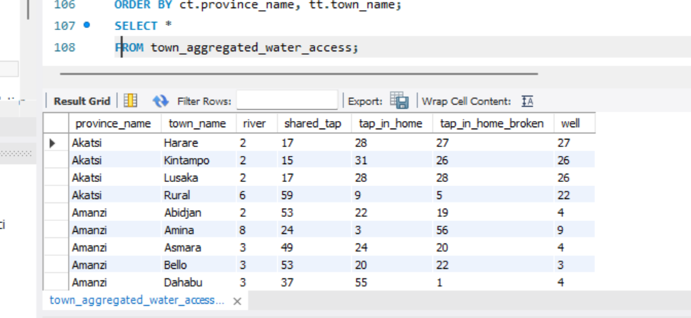
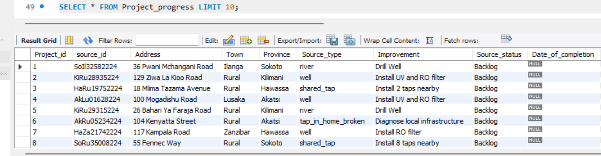
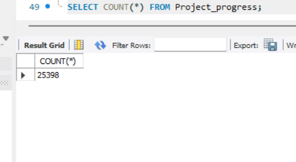

# Maji Ndogo Water Access — SQL Analysis

End-to-end SQL analysis of a national water survey (~27 million citizens,
2.5 years of field data), identifying which water sources serve the most
people, where queues are worst, and what repairs would have the highest impact.

## Background

Maji Ndogo is a fictional country whose water crisis was documented by
field surveyors. This project analyses that survey data to answer:

**Where should limited repair resources go first?**

## Dataset

Eight tables: `employee`, `location`, `visits`, `water_source`,
`water_quality`, `well_pollution`, `global_water_access`, `data_dictionary`.

Core columns: `source_id`, `type_of_water_source`, `number_of_people_served`,
`time_in_queue`, `time_of_record`, `biological`, `province_name`, `town_name`.

## Approach

### Part 1 — Data exploration and quality audit

| Step | What I did |
|---|---|
| **Exploration** | Listed all tables with `SHOW TABLES`; sampled each with `SELECT * ... LIMIT 5`; identified 5 water source types |
| **Quality audit** | Cross-checked `well_pollution` records where `results = 'Clean'` but `biological > 0.01` — found **38 misclassified rows** |
| **Root cause** | Some records had `description` beginning with the word "Clean" (e.g. `'Clean Bacteria: E. coli'`), and data-entry staff used that prefix instead of the actual `biological` value to set `results` |
| **Deeper audit** | After fixing results, corrected an escaping bug in my own audit query (`Clean\_%` → `Clean %`) which had been silently matching nothing — revealed **26 more misclassified descriptions** |
| **Safe cleaning** | Applied all `UPDATE` statements to a copy table first, verified with a `SELECT` audit query, then applied to the live table |

### Part 2 — Analysis

| Step | What I did |
|---|---|
| **Cleaning** | Generated employee emails with `CONCAT`/`LOWER`/`REPLACE`; fixed phone numbers with `TRIM` |
| **Location analysis** | Counted sources per town, province, and location type; calculated rural vs urban split |
| **Source analysis** | Counted sources by type, averaged people per source, calculated total population served, ranked by impact using `RANK()` |
| **Queue analysis** | Survey duration with `DATEDIFF`; average queue time with `NULLIF` to exclude zero-queue sources; queue times by day and hour |
| **Pivot table in SQL** | Built a day-of-week × hour-of-day matrix using `CASE` inside `AVG` (conditional aggregation) |

## Data quality verification

## Data quality verification

After all corrections, the audit query returns zero rows — every record
in `well_pollution` now agrees with its own measurement:

Phone number cleanup also verified — every number is now the expected
12 characters, with no trailing spaces:

## Field team highlights

Top 3 surveyors by number of visits — three people who completed over
18% of the entire survey between them:

Full contact details for the top 3 — cleaned names, emails, and phone
numbers ready for President Naledi's commendation messages:

Full audit narrative: see [`02_data_quality_audit.sql`](02_data_quality_audit.sql).

### Part 3 — Forensic Analysis: The Auditor's Report

After the initial water access analysis, an independent audit was conducted to verify the integrity of the surveyor data. By joining the auditor's re-examined scores to the original surveyor scores via the `visits` table, I identified **102 records** where the recorded water quality score did not match the independent audit.

Using CTEs to calculate the average number of mistakes per employee, I filtered for surveyors with an above-average error rate. Cross-referencing their records with the auditor's raw field statements revealed a clear pattern of bribery and corruption ("cash" mentions).

**The Evidence:**
Four field surveyors (Bello Azibo, Zuriel Matembo, Malachi Mavuso, and Lalitha Kaburi) were identified as suspects. They accounted for the highest number of incorrect scores, and *only* these four had statements alleging bribery. 

You can review the forensic queries here: [`10_corruption_evidence.sql`](10_corruption_evidence.sql).

### Part 4 — From Analysis to Action

The final phase of the project translated the historical analysis into an actionable operational plan. Using a master `combined_analysis_table` view, I built town-level and province-level pivot tables to identify exactly where the water access gaps were largest. 

*   **Sokoto** relies heavily on river water (identified via the pivot table), indicating a need for immediate well-drilling.
*   **Amanzi** has extensive home infrastructure, but the vast majority of it is broken, pointing to a systemic infrastructure failure rather than a lack of taps.

**The Deliverable: The Engineering Job List**
To make this data actionable, I created a `Project_progress` table to act as an automated job list for the engineering teams. Using complex `CASE` logic, the SQL script assigns specific interventions to over 25,000 water sources based on their profile:
*   Contaminated wells are assigned UV or RO filters.
*   Rivers are assigned new well-drilling projects.
*   Shared taps with long queues are assigned a calculated number of new taps to install nearby (`FLOOR(time_in_queue / 30)`).
*   Broken home taps are assigned to infrastructure diagnosis teams.

Engineers can now update the `Source_status` in this table (from 'Backlog' to 'In progress' to 'Complete') as they work, providing real-time progress tracking for the President's office.

Here is the town-level pivot analysis showing the percentage breakdown of water sources:

And here is a preview of the automated engineering job list generated by the `INSERT INTO` query:

Finally, the verification that all 25,398 actionable jobs were successfully inserted into the database:

## Key findings

- **60% of water sources are rural** — repair teams face harder logistics
- **43% of citizens use shared taps** — about 2,000 people per tap on average
- **31% have water infrastructure at home**, but **45% of those are broken**
- **18% use wells**, and only **28% of wells are clean**
- **Average queue time is 123 minutes** — four times the UN's 30-minute standard
- **Saturday queues are ~2× weekday queues**; morning and evening are the busiest hours
- **Wednesdays and Sundays have the shortest queues**
- **Some records show queue times over 500 minutes** — 8+ hours for water

## Important data caveat

`tap_in_home` and `tap_in_home_broken` records are **not one row per household**.
Surveyors combined ~160 nearby households into one record, so
`number_of_people_served = 956` means roughly 160 homes × 6 people,
not one tap serving 956 people individually. Any analysis of
"people per tap" must account for this — otherwise the average is
inflated by ~100×.
On average, one `tap_in_home` record represents ~107 households
(644 people ÷ 6 per household), not a single tap.

This is documented in `02_data_quality_audit.sql` because it materially
affects interpretation.

## Recommendations

1. **Fix shared taps first** — they serve the most people per intervention
2. **Repair broken home infrastructure** — one repair can relieve queue pressure for an entire neighbourhood
3. **Install UV/RO filters on wells** — cheapest way to make existing water safe
4. **Dispatch tankers to Saturday peak hours** as a short-term fix while taps are installed

## Tools used

MySQL 8.0, MySQL Workbench — window functions, CTEs, `CASE`, `NULLIF`,
`RANK`, date-time functions, conditional aggregation, `LIKE`-based cleaning.

## Author

Sheriff Balogun — [www.linkedin.com/in/sheriff-o-balogun](https://www.linkedin.com/in/sheriff-o-balogun) — Civil engineer transitioning to data analytics.